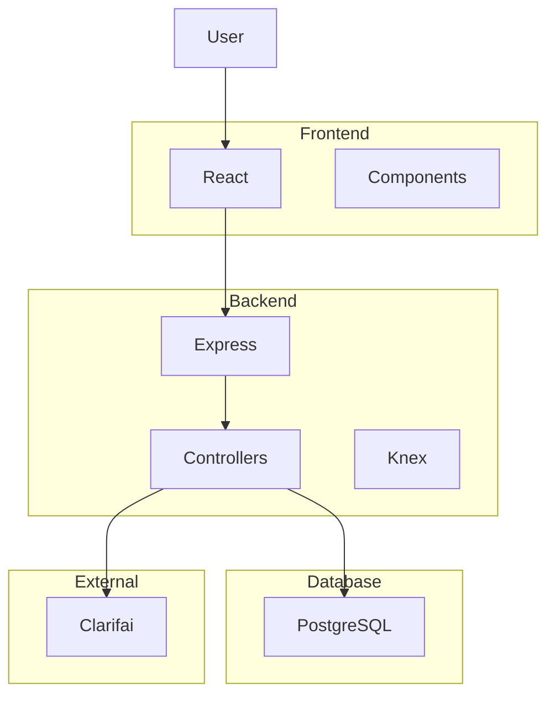
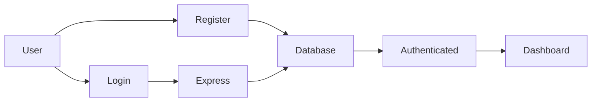
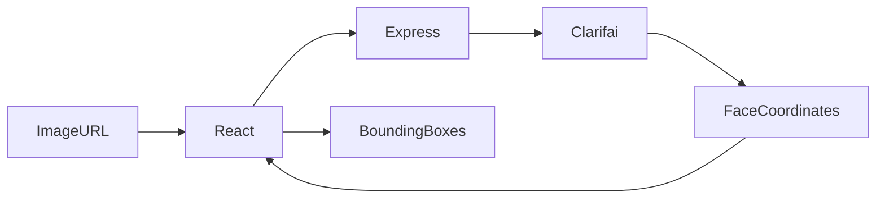

# Face Recognition

<p align="center">
  <h1 align="center">Face Recognition</h1>

  <p align="center">
    A full-stack web application that detects human faces in images using the Clarifai Face Detection API.
  </p>

  <p align="center">
    Built with <strong>React</strong>, <strong>Node.js</strong>, <strong>Express</strong>, <strong>PostgreSQL</strong>, <strong>Knex.js</strong>, and <strong>Clarifai</strong>.
  </p>
</p>

---

# Overview

Face Recognition is a full-stack application that allows users to create an account, sign in securely, and detect faces in images by submitting publicly accessible image URLs.

The application integrates the Clarifai Face Detection API to identify facial regions while maintaining user accounts and tracking the total number of successful image detections. It demonstrates a complete client-server architecture with authentication, REST APIs, database persistence, and third-party API integration.

This project showcases practical backend development, API consumption, state management, database interaction, and frontend visualization.

---

# Features

### User Authentication

- User registration
- User sign in
- Password hashing with bcrypt
- Persistent user profiles

### Face Detection

- Submit image URLs
- Detect faces using Clarifai
- Display bounding boxes
- Multiple face support (API dependent)

### User Profiles

- Track image submissions
- Display user ranking
- Store user information
- Update detection count

### Backend API

- RESTful Express API
- PostgreSQL database
- Knex query builder
- Third-party API integration

### User Experience

- Responsive interface
- Animated background
- Interactive UI components
- Clean navigation

---

# Technical Highlights

- Full-stack architecture
- React frontend
- Express REST API
- PostgreSQL persistence
- Knex query builder
- Clarifai AI integration
- Password hashing
- Modular backend controllers
- Component-based frontend
- Separation of frontend and backend

---

# System Architecture



---

# Authentication Flow



---

# Face Detection Flow



---

# Technology Stack

## Frontend

- React
- Vite
- Tachyons
- React Parallax Tilt
- Particles Background

## Backend

- Node.js
- Express

## Database

- PostgreSQL
- Knex.js

## Authentication

- bcrypt-nodejs

## External APIs

- Clarifai Face Detection API

---

# Project Structure

```
face-recognition/

├── face-recognition-app/
│   ├── src/
│   ├── components/
│   ├── App.jsx
│   └── package.json
│
├── face-recognition-api/
│   ├── controllers/
│   ├── server.js
│   └── package.json
```

### Directory Overview

| Directory | Purpose |
|------------|----------|
| `face-recognition-app` | React frontend |
| `face-recognition-api` | Express backend |
| `controllers` | Business logic for authentication, profiles, and image processing |

---

# Backend API

| Method | Endpoint | Description |
|----------|----------|-------------|
| POST | `/signin` | Authenticate a user |
| POST | `/register` | Create a new account |
| GET | `/profile/:id` | Retrieve a user profile |
| PUT | `/image` | Increment image submission count |
| POST | `/imageurl` | Send image to Clarifai API |

---

# Database Overview

The application stores user information in PostgreSQL.

Typical user data includes:

- Name
- Email
- Password hash
- Join date
- Image submission count

The backend uses Knex.js to manage database queries and updates.

---

# Installation

Clone the repository.

```bash
git clone https://github.com/kishky101/face-recognition.git
```

Install frontend dependencies.

```bash
cd face-recognition-app
npm install
```

Install backend dependencies.

```bash
cd ../face-recognition-api
npm install
```

Start the backend.

```bash
npm start
```

Start the frontend.

```bash
npm run dev
```

---

# Environment Variables

Configure the backend with the following variables.

```env
DATABASE_HOST=

DATABASE_PORT=

DATABASE_USER=

DATABASE_PASSWORD=

DATABASE_NAME=

CLARIFAI_API_KEY=
```

---

# Available Scripts

## Frontend

```bash
npm run dev
```

Runs the development server.

```bash
npm run build
```

Creates a production build.

```bash
npm run preview
```

Serves the production build locally.

## Backend

```bash
npm start
```

Starts the Express server using Nodemon.

---

# Engineering Decisions

### React Component Architecture

The frontend is divided into reusable UI components responsible for navigation, registration, authentication, ranking, image submission, and face visualization.

### Express Controllers

Business logic is separated into dedicated controllers, improving maintainability and keeping routing concerns isolated.

### PostgreSQL + Knex

Knex provides database abstraction while retaining SQL flexibility, making queries easier to maintain and extend.

### Clarifai Integration

Rather than performing machine learning locally, the application delegates face detection to Clarifai, demonstrating practical third-party AI service integration.

---

# Performance Considerations

- Modular backend architecture
- Stateless REST API
- Client-side rendering with React
- Lightweight API requests
- Efficient database updates for user rankings

---

# Security Considerations

- Password hashing using bcrypt
- Credentials stored securely in PostgreSQL
- API keys managed through environment variables
- Authentication handled server-side

---

# Testing

Automated testing has not been implemented.

Recommended additions:

- Jest
- Supertest
- React Testing Library
- GitHub Actions

---

# Deployment

The project can be deployed by hosting:

- React frontend on Vercel or Netlify
- Express backend on Render, Railway, or Fly.io
- PostgreSQL using a managed database provider

A valid Clarifai API key is required for face detection.

---

# Future Improvements

- Drag-and-drop image uploads
- Upload images directly from local storage
- JWT authentication
- Refresh tokens
- User avatars
- Detection history
- Image gallery
- Docker support
- CI/CD pipeline
- End-to-end testing
- Face recognition history dashboard

---

# Contributing

Contributions are welcome.

If you'd like to improve the project, fork the repository, create a feature branch, and submit a pull request.

---

# License

This project is licensed under the MIT License.

---

# Acknowledgements

This project uses several excellent open-source technologies and services:

- React
- Express
- PostgreSQL
- Knex.js
- Clarifai
- Tachyons
- Vite
