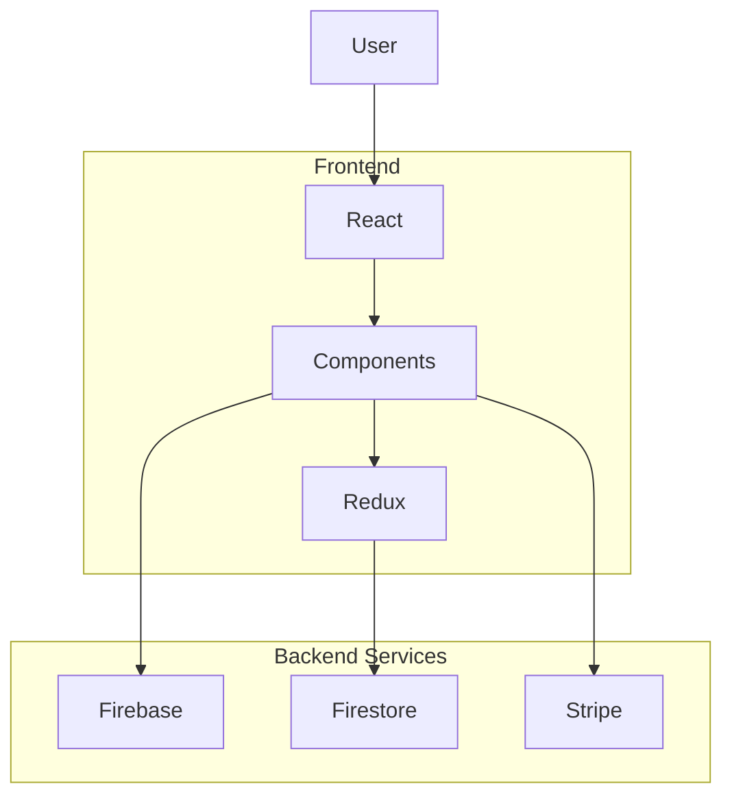

# Crown Clothing

<p align="center">
  <h1 align="center">Crown Clothing</h1>

  <p align="center">
    A modern e-commerce platform built with React, Redux Toolkit, Firebase Authentication, Stripe, and TypeScript.
  </p>

  <p align="center">
    Designed to demonstrate scalable frontend architecture, centralized state management, secure authentication, and payment processing.
  </p>
</p>

---

# Overview

Crown Clothing is a full-stack-inspired e-commerce application that simulates the shopping experience of a modern online retail platform.

The application enables users to browse products by category, authenticate using Firebase, manage a persistent shopping cart, and complete payments securely through Stripe.

The project showcases scalable React architecture, centralized state management with Redux Toolkit, reusable UI components, route-based code organization, Firebase integration, and responsive user interface design.

---

# Features

## Authentication

- User registration
- User sign in
- Google Authentication
- Firebase Authentication
- Persistent sessions

---

## Shopping Experience

- Browse product categories
- Product detail browsing
- Shopping cart
- Quantity management
- Checkout experience

---

## Payments

- Secure Stripe integration
- Payment processing
- Checkout workflow

---

## User Experience

- Responsive interface
- Modern navigation
- Dynamic shopping cart
- Loading states
- Clean product browsing

---

## State Management

- Redux Toolkit
- Redux Persist
- Memoized selectors
- Global application state

---

# Technical Highlights

- React 18
- TypeScript
- Redux Toolkit
- Firebase Authentication
- Cloud Firestore
- Stripe Payments
- React Router v6
- Styled Components
- Component-driven architecture
- Scalable folder organization

---

# System Architecture



---

# Authentication Flow


---

# Checkout Flow


---

# Technology Stack

## Frontend

- React 18
- TypeScript
- React Router v6
- Styled Components

## State Management

- Redux Toolkit
- Redux Persist
- Reselect

## Backend Services

- Firebase Authentication
- Cloud Firestore

## Payments

- Stripe

## Tooling

- Jest
- React Testing Library
- ESLint

---

# Project Structure

```
src/
│
├── assets/
├── components/
├── context/
├── routes/
├── store/
├── utils/
├── App.js
└── index.js
```

### Directory Overview

| Directory | Purpose |
|------------|----------|
| `components` | Reusable UI components |
| `routes` | Route-based application pages |
| `store` | Redux slices, selectors, and store configuration |
| `utils` | Firebase, Stripe, and shared utilities |
| `context` | Shared React context where applicable |
| `assets` | Images and static resources |

---

# Application Architecture

The application follows a feature-oriented architecture that separates presentation, routing, business logic, and state management.

Core responsibilities include:

- UI rendering through reusable React components
- Centralized application state with Redux Toolkit
- Authentication handled by Firebase
- Product data stored in Firestore
- Secure payment processing with Stripe

This separation improves maintainability and allows individual features to evolve independently.

---

# State Management

Application state is managed using Redux Toolkit.

Global state includes:

- Current user
- Shopping cart
- Product categories
- UI state

Selectors are used to efficiently derive computed state while minimizing unnecessary re-renders.

---

# Authentication

User authentication is managed through Firebase Authentication.

Supported methods include:

- Email and password
- Google Sign-In

Authenticated user information is synchronized with the application state and persisted across sessions.

---

# Database Overview

Cloud Firestore stores:

- Product collections
- Product categories
- User profiles

The frontend retrieves product data dynamically, allowing inventory to be managed independently of the application code.

---

# Payment Processing

Payments are processed securely using Stripe.

Sensitive payment information is never handled directly by the frontend and is delegated to Stripe's payment infrastructure.

---

# Installation

Clone the repository.

```bash
git clone https://github.com/kishky101/crown-clothing.git
```

Navigate into the project.

```bash
cd crown-clothing
```

Install dependencies.

```bash
npm install
```

Start the development server.

```bash
npm start
```

---

# Environment Variables

Create a `.env` file and configure the required credentials.

```env
REACT_APP_FIREBASE_API_KEY=

REACT_APP_FIREBASE_AUTH_DOMAIN=

REACT_APP_FIREBASE_PROJECT_ID=

REACT_APP_FIREBASE_STORAGE_BUCKET=

REACT_APP_FIREBASE_MESSAGING_SENDER_ID=

REACT_APP_FIREBASE_APP_ID=

REACT_APP_STRIPE_PUBLISHABLE_KEY=
```

---

# Available Scripts

```bash
npm start
```

Runs the development server.

```bash
npm run build
```

Builds the application for production.

```bash
npm test
```

Runs the test suite.

---

# Engineering Decisions

### Redux Toolkit

Redux Toolkit centralizes application state while reducing boilerplate and improving maintainability through slices and modern Redux patterns.

### Firebase

Firebase provides authentication and cloud-hosted data storage without requiring a custom backend, allowing the application to focus on frontend architecture.

### React Router

React Router v6 enables route-based application structure with clear separation between authentication, shopping, and checkout experiences.

### Styled Components

Component-scoped styling improves modularity and prevents style leakage while supporting reusable UI patterns.

### Stripe

Stripe was chosen to demonstrate integration with an industry-standard payment platform while maintaining secure payment handling.

---

# Performance Considerations

- Memoized Redux selectors
- Optimized component rendering
- Route-based code organization
- Centralized state updates
- Efficient Firestore data fetching

---

# Security Considerations

- Firebase Authentication
- Protected checkout flow
- Secure Stripe payment processing
- Environment variables for API credentials
- Authentication state validation

---

# Testing

The project includes support for:

- Jest
- React Testing Library

Future improvements could include:

- Cypress
- Playwright
- End-to-end checkout testing

---

# Deployment

The application can be deployed using:

- Vercel
- Netlify

Required services:

- Firebase Project
- Cloud Firestore
- Stripe Account

---

# Future Improvements

- Product search
- Product reviews
- Wishlist functionality
- Order history
- Admin dashboard
- Inventory management
- Discount codes
- Address management
- Docker support
- GitHub Actions CI/CD

---

# Contributing

Contributions are welcome.

If you'd like to improve the project, fork the repository, create a feature branch, and submit a pull request.

---

# License

This project is licensed under the MIT License.

---

# Acknowledgements

This project is powered by several outstanding technologies:

- React
- Redux Toolkit
- Firebase
- Cloud Firestore
- Stripe
- Styled Components
- React Router
- TypeScript
